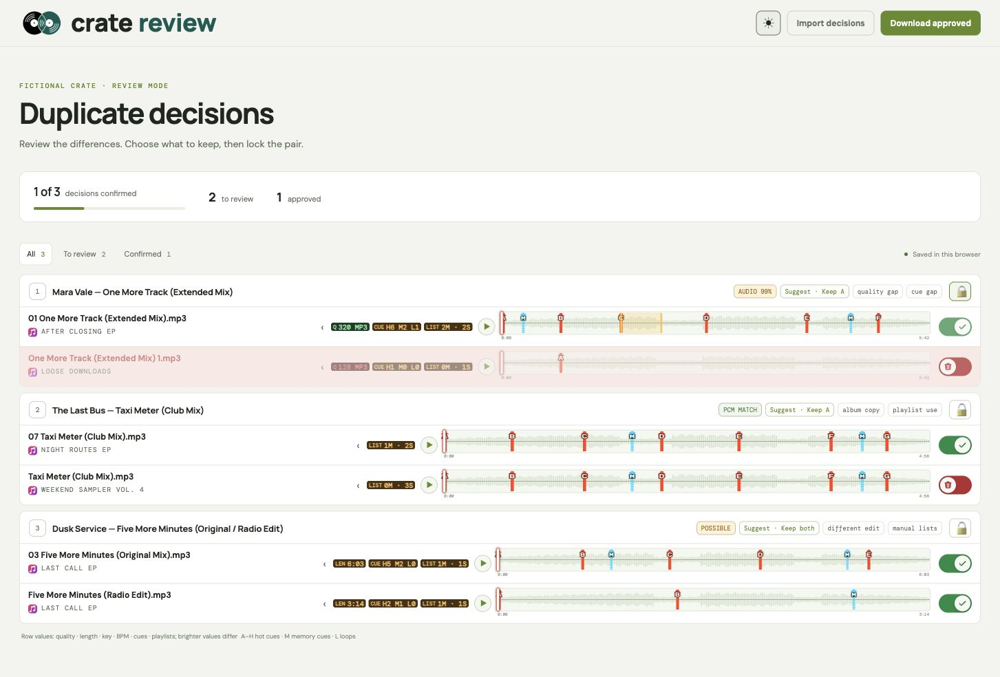
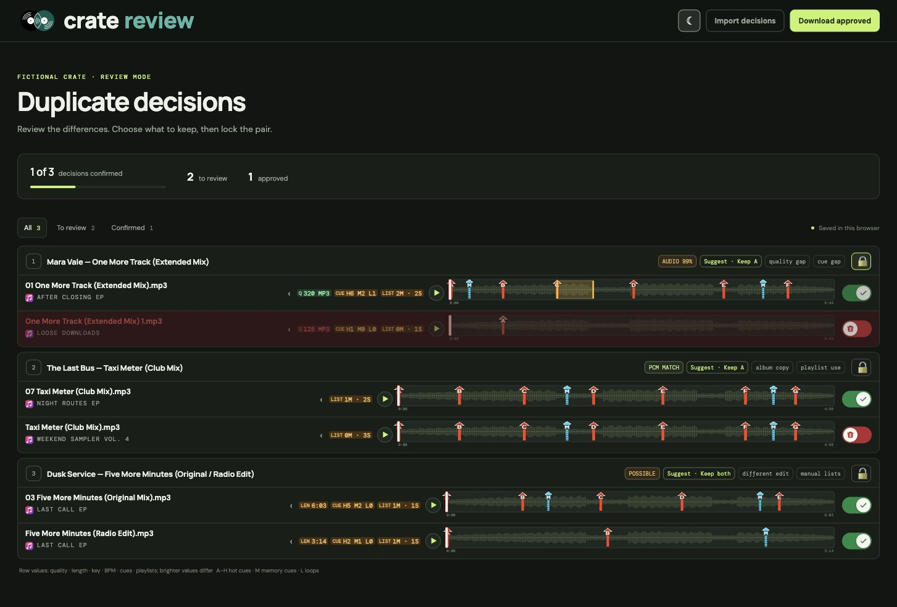

# crate review

Two copies of a tune can hide very different stories: one has your hot cues, one has the better audio file, and one might be in a set playlist. **Crate Review puts the evidence side by side so you can clear duplicates without binning the copy you actually play.**


## Make the call with your ears and your prep

- **Audition both copies.** Play and seek through compact audio-derived waveforms with Rekordbox hot cues, memory cues, and loops marked in place.
- **See what matters.** Compare bitrate, length, key, BPM, cue data, and playlist use. Matching properties stay out of the way until you expand them.
- **Trust the evidence.** Suggestions use audio comparisons alongside track details, not a matching title alone. Distinct edits and remixes deserve their own place in the crate.
- **Stay in control.** Choose which file to keep, lock your decision, and download an approval plan. The review page does not change your music or Rekordbox library.

## See the review

These screenshots use fictional tracks, playlists, and waveforms. The decisions show the sort of trade-offs DJs run into: a stronger copy of “One More Track”, an album copy of “Taxi Meter”, and two edits of “Five More Minutes” that should both survive.

**Light mode**



**Dark mode**



## Start a review

Crate Review currently runs locally on macOS. It reads a Rekordbox XML export and scans your Apple Music media folder by default. Install Python 3 and `ffmpeg`, export your collection from Rekordbox, then run:

```sh
python3 build_duplicate_sweep.py
```

Open `index.html` in your browser. The generator looks for `~/Documents/rekordbox/rekordbox.xml` and `~/Music/Music/Media.localized/Music` by default. Use `--xml` and `--library-root` if your files live elsewhere.

Rekordbox XML may not say which playlists are intelligent. If needed, put their names in the local `.local/playlist-types.json` file:

```json
{"intelligentPlaylists": ["Example automatic list"], "intelligentFolders": ["Example automatic folder"]}
```

Your candidate report, waveforms, playlist names, file paths, and approval exports stay local and are ignored by Git. **Downloading approvals records your choices; it does not delete anything.**
